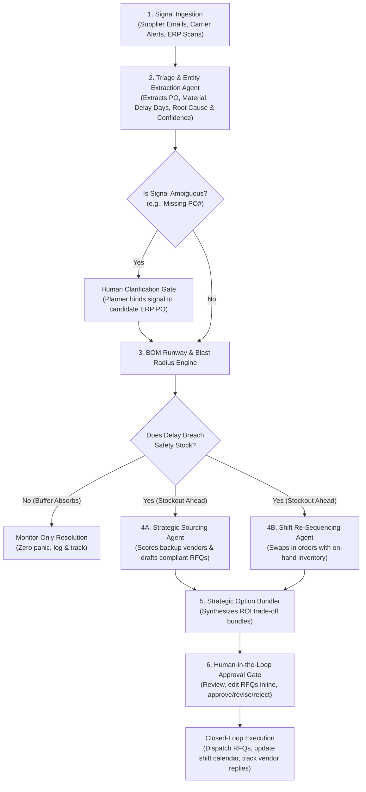

# ProcureX — SupplyChain AI Command Center
### Autonomous Supply Chain Exception Handler & Decision Intelligence Concept

---

## 1. Elevator Pitch

In discrete manufacturing, a single delayed shipment of raw materials can halt factory production lines within days, costing hundreds of thousands of dollars in idle labor and customer late-delivery penalties. **ProcureX (SupplyChain AI Command Center)** is an autonomous, multi-agent decision support concept that transforms how supply chain planners respond to disruptions. 

Instead of spending days manually cross-referencing emails, inventory spreadsheets, factory shift calendars, and vendor directories, **ProcureX** ingests unstructured disruption alerts, calculates the exact operational and financial blast radius, co-optimizes factory shift schedules alongside backup supplier sourcing, and presents a ready-to-execute mitigation plan with pre-drafted supplier negotiations—all within seconds, governed by a strict **Human-in-the-Loop (HITL)** approval gate.

---

## 2. The Problem: Why Supply Chain Exceptions Break Factories

Modern manufacturing plants run on lean, Just-in-Time (JIT) inventory buffers. While efficient during stable conditions, lean operations leave virtually zero margin for error when maritime congestion, customs holds, or supplier quality failures strike.

Today, when a critical shipment is delayed, materials planners face four compounding bottlenecks:

1. **Unstructured, Fragmented Signals**: Disruption notices arrive buried in free-text supplier emails, freight forwarder messages, or carrier notices—often with incomplete details or missing purchase order references.
2. **Siloed Impact Analysis ("The Spreadsheet Scramble")**: To understand what a delay actually means, a planner must manually check current warehouse stock, calculate daily consumption rates, trace Bill of Materials (BOM) dependencies to open customer orders, and review legal contracts to calculate daily Service Level Agreement (SLA) late penalties.
3. **Disconnected Factory & Procurement Decisions**: Procurement teams typically react to shortages in isolation—paying exorbitant premiums for emergency air/spot-market freight—without realizing that the factory floor could temporarily re-sequence production shifts to build other products whose raw materials are already in stock.
4. **Slow B2B Negotiation Cycles**: Qualifying backup vendors, checking capacity, verifying technical certifications, and drafting compliant Request for Quotation (RFQ) emails takes hours or days—while the clock toward factory line starvation keeps ticking.

> [!IMPORTANT]
> **The Core Insight**: By the time a traditional "war room" finishes calculating the impact of a supply chain delay, the window to execute a low-cost operational swap has often already closed.

---

## 3. The Solution: ProcureX Command Center

**ProcureX** bridges the gap between **external procurement** and **internal factory operations**. Rather than acting as a passive dashboard that merely flags a red warning light, ProcureX acts as an **autonomous operational co-pilot** that moves directly from *detection* to *quantified options* to *execution*.

### What Makes ProcureX Different?
- **Co-Optimization of Schedule + Sourcing**: Before spending money on expensive spot-market emergency supplies, ProcureX inspects the factory floor. If a production line is about to starve for Material A, ProcureX checks if that same line can pull forward a future order using Material B (already sitting in the warehouse). This "buys time" on the factory floor, shrinking the emergency sourcing requirement and allowing the plant to use a more affordable, reliable regional backup supplier.
- **Evidence-Grounded AI Triage**: Every extracted fact (delay duration, root cause, affected material) is linked directly to verbatim quotes from the source communication and scored for confidence.
- **Action-Ready Execution with Human Governance**: AI agents do the heavy analytical and drafting work in seconds, but a human planner retains final authority over financial commitments, schedule changes, and external vendor communications.

---

## 4. Conceptual Architecture & Multi-Agent Workflow

ProcureX coordinates six specialized intelligence stages in a single, seamless pipeline:

### The Six Core Stages Explained

#### Stage 1: Multi-Channel Signal Ingestion
Captures unstructured disruption signals—such as an urgent email from a supplier's logistics desk or an automated shipping manifest discrepancy—and brings them into a unified command stream.

#### Stage 2: Triage & Evidence Extraction
An AI triage agent reads the unstructured message to identify the affected Purchase Order, material specification, revised arrival date, delay duration, and root cause (e.g., port congestion, raw material batch hold, transit delay). It highlights verbatim evidence from the message and assigns a confidence score. If critical information is missing (such as a missing PO number), it pauses and presents candidate matches to the human planner before proceeding.

#### Stage 3: BOM Runway & Financial Blast Radius Engine
ProcureX cross-references the delayed shipment against live warehouse inventory and daily production burn rates over a 30-day horizon:
- Pinpoints the exact **Stockout Day** and **Safety Stock Breach Day**.
- Traces the **Bill of Materials (BOM)** to identify which customer orders on which factory lines will be starved of material.
- Calculates the **Total Unmitigated Financial Exposure**, combining:
  - **Idle Factory Line Costs** (labor and overhead wasted per halted shift).
  - **Customer SLA Penalties** (daily liquidated damages for late deliveries).

#### Stage 4: Parallel Mitigation Synthesis (Sourcing + Scheduling)
When a stockout is detected, two engines work in tandem:
1. **Factory Shift Re-Sequencing Agent**: Scans the 30-day factory shift calendar for the affected production line. It identifies future scheduled orders that use *unaffected materials already in stock* and pulls those shifts forward into the starvation window. This keeps factory workers and machinery productive while deferring the need for the delayed material by several days.
2. **Strategic Sourcing & RFQ Agent**: Evaluates pre-qualified backup suppliers using a weighted multi-criteria scorecard:
   - **Lead-Time Fit (40%)**: Can the supplier deliver before the stockout window opens?
   - **Historical Reliability (30%)**: Will they actually deliver on time?
   - **Unit Price & Freight Cost (20%)**: What is the financial premium?
   - **Available Capacity (10%)**: Can they cover the required bridge tonnage?
   
   The agent categorizes candidates into clear strategic archetypes (*Fastest Expedite*, *Balanced Recommended*, and *Lowest Cost*) and drafts tailored, commercially compliant RFQ emails for each.

#### Stage 5: Strategic Option Bundling & ROI Analysis
Instead of forcing the planner to piece together a solution, ProcureX packages complete **Mitigation Option Bundles** with side-by-side financial trade-offs:
- **Bundle 1 (Recommended — Operations + Procurement Synergy)**: Combines a factory shift swap with a regional backup supplier bridge order. Because the shift swap delays the date when additional material is needed, the plant avoids ultra-expensive emergency spot rates and achieves the highest Net Savings and ROI.
- **Bundle 2 (Alternative — Pure Procurement Expedite)**: Leaves the factory schedule untouched and splits an emergency spot buy across fast-turnaround and regional backup vendors—useful if the plant manager prefers not to pay tooling changeover costs.

#### Stage 6: Human-in-the-Loop (HITL) Governance & Loop Closure
The planner reviews the visual impact curves, inspects the before-and-after shift calendar, edits the drafted RFQ emails directly if desired, and clicks **Approve**, **Request Revision**, or **Reject**. Upon approval, ProcureX updates the production schedule, dispatches the RFQs, logs an immutable compliance trail, and tracks incoming supplier confirmations and counter-offers.

---

## 5. Flagship Case Study: The "Golden Scenario"

To illustrate the tangible business value of **ProcureX**, consider a realistic crisis at an automotive & industrial stamping facility:

### The Crisis
- **The Signal**: A primary steel supplier sends an urgent notice that a shipment of **140 metric tons of Cold-Rolled Steel Coil** (`PO-8842`) is stuck at port due to severe vessel berth congestion. Delivery is pushed back by **+14 days** (from Day 5 to Day 19).
- **The Operational Reality**: The plant only holds **48 tons** of steel on hand, burning **8 tons per day** across two daily shifts on **Line A (Heavy Press Stamping)**.
- **Unmitigated Outcome**:
  - Warehouse steel hits zero on **Day 6**.
  - Line A sits completely idle for **13 days (26 shifts)** waiting for the vessel to arrive on Day 19, costing **\$169,000** in wasted shift labor and overhead.
  - Two major customer contracts miss their delivery deadlines, triggering **\$45,000** and **\$21,000** in contractual SLA penalties.
  - **Total Unmitigated Loss: \$235,000**.

### How ProcureX Solves It in Seconds
1. **Shift Swap Discovery**: ProcureX notices that Line A is scheduled later in the month to stamp **Aluminum Hood Panels**, and the warehouse already has **120 tons of Aluminum Sheet** sitting in stock. It pulls **4 days (8 shifts)** of Aluminum production forward into **Days 6–9** (incurring only **\$3,000** in die/tooling changeover costs).
2. **Shrinking the Bridge Gap**: Because Line A is now busy stamping aluminum from Day 6 to Day 9, steel is no longer needed until **Day 10**. This shrinks the steel shortage window from 13 days down to 9 days (**72 tons** needed instead of 104 tons) and gives backup suppliers an 8-day lead-time runway instead of just 5 days.
3. **Smart Regional Sourcing**: With 8 days of breathing room, ProcureX bypasses the expensive spot-market broker and selects a reliable regional mill capable of delivering 72 tons by Day 8 for a modest price and freight premium (**\$10,920**).

### Financial Comparison

| Metric | Unmitigated Crisis | Option Bundle 2 (Spot Expedite Only) | Option Bundle 1 (Shift Swap + Regional Mill) |
| :--- | :--- | :--- | :--- |
| **Factory Schedule Change** | None (Line starves) | None (Schedule unchanged) | **Swap 8 Aluminum shifts into Days 6–9** |
| **Idle Factory Shifts** | 26 shifts (\$169,000 loss) | 0 shifts | **0 shifts** |
| **Late Customer Orders** | 2 orders (\$66,000 penalties) | 0 orders | **0 orders** |
| **Total Financial Exposure** | **\$235,000** | \$235,000 | **\$235,000** |
| **Mitigation Cost (Premium + Freight + Tooling)** | \$0 | \$18,200 | **\$13,920** |
| **Net Financial Savings** | **-\$235,000 (Loss)** | **+\$216,800 Saved** | **+\$221,080 Saved** |
| **Return on Mitigation Spend (ROI)** | N/A | 11.9x ROI | **15.9x ROI** |

---

## 6. Four Real-World Scenarios Built into the Concept

A credible industrial system must not overreact to every minor delay or hallucinate when given incomplete data. ProcureX is designed around four distinct operational archetypes:

| Scenario Archetype | Trigger Signal | System Intelligence & Behavior | Business Outcome |
| :--- | :--- | :--- | :--- |
| **1. Major Raw Material Delay** *(Flagship)* | +14-day maritime port delay on 140t Cold-Rolled Steel (`PO-8842`) | Detects Day 6 stockout; co-optimizes Line A Aluminum shift swap + 72t regional mill bridge order. | **\$221,080 Net Saved (15.9x ROI)**; 0 idle shifts, 0 late orders. |
| **2. Partial Shipment Shortage** | Carrier notice reports 40% quantity shortfall on Polyamide Resin (`PO-9210` — 30t arriving instead of 50t) | Calculates that reduced delivery shortens runway; triggers targeted backup resin compounding order to protect Line B assembly. | Prevents mid-run Line B starvation and protects customer manifold deliveries. |
| **3. Minor Transit Delay** *(Anti-Panic Test)* | +2-day highway inspection delay on High-Tensile Fasteners (`PO-9104`) | Simulates 30-day inventory curve and verifies existing warehouse buffer safely absorbs the 2-day slip above safety stock. | Recommends **MONITOR ONLY**—spends **\$0** on unnecessary expedites. |
| **4. Ambiguous Supplier Email** *(Safety Gate Test)* | Vague email from a steel mill warns of a rolling-mill equipment delay but **omits the PO number** | Refuses to guess; halts pipeline at the **Human Clarification Gate** and surfaces matching open POs (`PO-8842` vs. `PO-8899`) for 1-click binding. | Eliminates AI hallucination risk in high-stakes procurement. |

---

## 7. Responsible AI & Human-in-the-Loop Guardrails

In industrial supply chains, sending an inaccurate purchase inquiry or changing a factory schedule without authorization can cause severe operational disruption. **ProcureX** embeds governance at every layer:

- **Automated Commercial & Technical Guardrails**: Before any drafted RFQ email is shown to the planner, an internal validator checks that it explicitly includes mandatory technical specifications (e.g., material grade standards), delivery Incoterms, target dock arrival dates, and late-delivery SLA clauses.
- **Verbatim Evidence Attribution**: Every AI extraction highlights the exact sentence from the inbound email that justified the alert, allowing a human planner to verify accuracy in a single glance.
- **Inline Human Editing**: Planners can modify email subjects, negotiation terms, or requested quantities directly inside the Command Center before dispatch.
- **Full Decision Audit Trail**: Every automated calculation, AI recommendation, human clarification, and operator approval is recorded in a chronological audit log for organizational compliance.

---

## 8. The Command Center User Experience

ProcureX is designed as a clean, high-clarity **Supply Chain Command Center** tailored for rapid executive and planner decision-making:

1. **Executive KPI & Savings Ticker**: At-a-glance visibility into total financial risk exposure, projected net savings, ROI multiple, and active plant status.
2. **Interactive Scenario Simulator**: Allows planners (and hackathon judges) to inject realistic disruption emails, carrier webhooks, or custom free-text messages and watch the multi-agent pipeline reason in real time.
3. **30-Day Inventory Runway Curve**: Visualizes the unmitigated inventory drop-off (crashing into zero) alongside the mitigated recovery trajectory that stays safely above minimum buffer thresholds.
4. **Before-vs-After Factory Shift Grid**: A 60-shift visual calendar showing exactly which starved production shifts are replaced by pulled-forward orders and covered by bridge deliveries.
5. **Multi-Supplier Scorecard & Editable RFQ Composer**: Ranks backup vendors side-by-side across price, lead time, capacity, and reliability, paired with ready-to-send negotiation drafts.
6. **Closed-Loop Supplier Reply Simulation**: Demonstrates the complete lifecycle after approval by simulating realistic vendor confirmations, delivery slot commitments, and counter-offers.

---

## 9. Measurable Impact & Future Vision

### Target Impact Metrics
- **Response Time Reduction**: Compresses exception triage, impact modeling, and RFQ drafting from **24–48 hours** of cross-departmental meetings down to **under 3 minutes** of human review.
- **Capital Efficiency**: Reduces emergency spot-buying costs by **25–40%** through intelligent internal shift re-sequencing.
- **Zero Unplanned Downtime**: Protects continuous factory line utilization and preserves Tier-1 customer delivery ratings.

### Future Roadmap
1. **Multi-Tier Supply Network Graph**: Expand beyond Tier-1 direct suppliers to detect upstream sub-supplier disruptions (e.g., raw ore, chemical precursors, regional energy outages) before Tier-1 vendors even send a delay email.
2. **Proactive Global Risk Sensing**: Combine internal ERP inventory data with live maritime vessel tracking, port congestion feeds, and severe weather alerts to predict ETA slips days in advance.
3. **Autonomous Counter-Offer Negotiation**: Enable the Sourcing Agent to automatically parse incoming supplier counter-offers (e.g., split deliveries or price adjustments), recalculate the ROI bundle in real time, and recommend optimal counter-proposals.
4. **Bi-Directional ERP & MES Connectors**: Seamless plug-and-play integration with enterprise ERP and Manufacturing Execution Systems (SAP, Oracle, NetSuite) for instant production order updates upon human approval.
